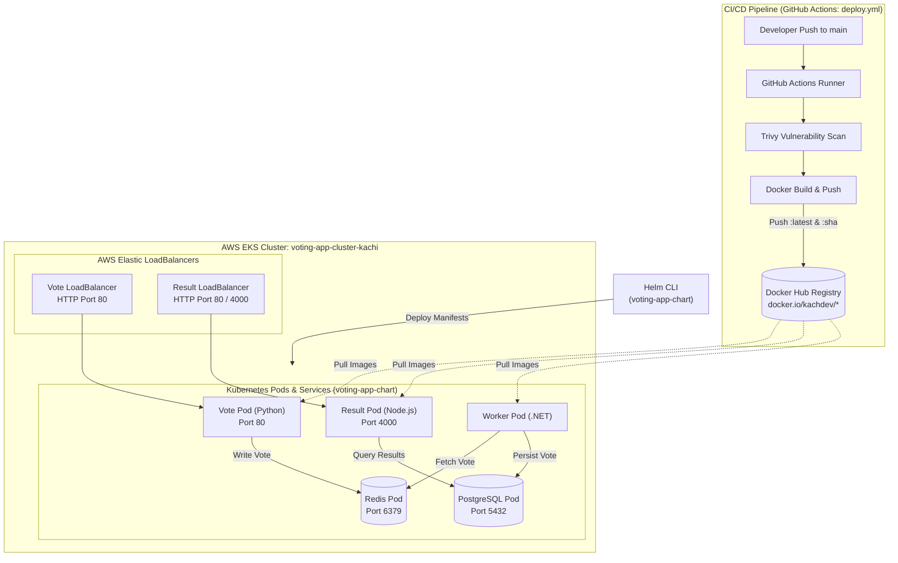

# Example Voting App (DevOps Capstone 1)

A fully containerized, microservices-based distributed voting application deployed onto **AWS Elastic Kubernetes Service (EKS)** using **Terraform**, **Helm**, and automated with a **GitHub Actions CI/CD pipeline**.

---

## Architecture Overview

The application is composed of five specialized microservices:

* **Vote (`vote`)**: A Python/Flask front-end web application that allows users to cast a vote between two choices.
* **Redis (`redis`)**: An in-memory queue that temporarily stores incoming votes from the vote service.
* **Worker (`worker`)**: A .NET background service that consumes votes from Redis and persists them into the database.
* **Database (`db`)**: A PostgreSQL database backed by persistent storage that maintains the tally of votes.
* **Result (`result`)**: A Node.js and Socket.IO web application that queries the PostgreSQL database and displays real-time voting results to users.

---

## System Architecture Diagram



---

## Prerequisites

Before deploying the application, ensure the following CLI tools are installed and configured:

1. **[AWS CLI v2](https://docs.aws.amazon.com/cli/latest/userguide/install-cliv2.html)**: Configured with your AWS credentials (`aws configure`).
2. **[Terraform](https://www.terraform.io/downloads.html)** (>= 1.3.0): Used to provision EKS infrastructure and IAM roles.
3. **[kubectl](https://kubernetes.io/docs/tasks/tools/)**: To inspect and interact with the Kubernetes cluster.
4. **[Helm v3](https://helm.sh/docs/intro/install/)**: Kubernetes package manager used for deploying the application chart.
5. **[Docker Desktop](https://www.docker.com/)**: For building or running containers locally.

---

## Step-by-Step Deployment Guide

### 1. Provision Infrastructure with Terraform

Navigate into the `terraform/` directory to initialize and provision the AWS EKS cluster (`voting-app-cluster-kachi`):

```bash
cd terraform
terraform init
terraform plan
terraform apply
```

*(Enter `yes` when prompted. EKS provisioning takes approximately 10–15 minutes).*

### 2. Configure kubectl for EKS

Once Terraform completes, update your local kubeconfig to authenticate with your new cluster:

```bash
aws eks update-kubeconfig --region us-east-1 --name voting-app-cluster-kachi
```

Verify your cluster connection and nodes:

```bash
kubectl get nodes
```

### 3. Deploy via Helm Chart

From the root of the repository, deploy or upgrade the voting application using Helm:

```bash
helm upgrade --install voting-app ./voting-app-chart
```

To customize parameters such as the Docker Hub username, update `voting-app-chart/values.yaml` or pass values inline:

```bash
helm upgrade --install voting-app ./voting-app-chart --set global.username=kachdev
```

### 4. Verify Deployments & Services

Check that all pods are up and running:

```bash
kubectl get pods
```

Expected output:
```text
NAME                      READY   STATUS    RESTARTS   AGE
db-76f46dd747-z2tmk       1/1     Running   0          ...
redis-74f58cd5db-fzvnq    1/1     Running   0          ...
result-8b4558555-nqp9j    1/1     Running   0          ...
vote-6f56f4bbff-c8gpl     1/1     Running   0          ...
worker-59bc4444c-bznlm    1/1     Running   0          ...
```

Retrieve the external URLs allocated by the AWS Elastic LoadBalancers:

```bash
kubectl get svc
```

* **Vote UI**: Access via the external URL of `vote` service on port `80`.
* **Result UI**: Access via the external URL of `result` service on port `80` (routing to container port `4000`).

---

## CI/CD Pipeline (GitHub Actions)

The continuous integration and deployment pipeline is defined in [`.github/workflows/deploy.yml`](.github/workflows/deploy.yml) and runs on every push to the `main` branch:

1. **Checkout**: Retrieves source code.
2. **Docker Hub Authentication**: Securely authenticates using GitHub repository secrets (`DOCKER_USERNAME` and `DOCKER_PASSWORD`).
3. **Security Scan**: Executes **Trivy** vulnerability scanner across filesystem dependencies.
4. **Container Build & Push**:
   * Pushes hardened Python Vote image: `kachdev/voting-app-vote:latest` & `kachdev/voting-app-vote:<SHA>`
   * Pushes Alpine Node.js Result image: `kachdev/voting-app-result:latest` & `kachdev/voting-app-result:<SHA>`
   * Pushes .NET Worker runtime image: `kachdev/voting-app-worker:latest` & `kachdev/voting-app-worker:<SHA>`

---

## Local Development (Docker Compose)

To test the application locally:

```bash
docker compose up -d
```

* Vote: [http://localhost:8080](http://localhost:8080)
* Result: [http://localhost:8081](http://localhost:8081)
